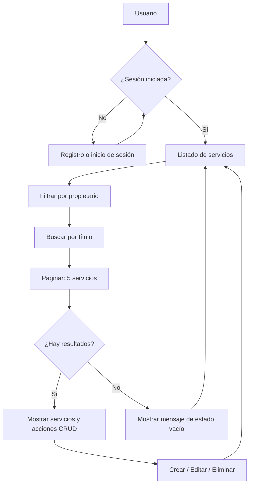

# Práctica final U4P3 — Aplicaciones Web

**Alumno:** Duarte Ruiz Sebastián · **Grupo:** DSM4-1  
**Repositorio:** https://github.com/duarteruizsebastian/u4p3-duarte-ruiz-sebastian

Implementa Categoria, Factura, DetalleFactura, migraciones escalonadas conservando los datos, seis reportes SQL manuales, índices y exportación CSV.

## Inicio
```powershell
python -m venv venv
.\venv\Scripts\Activate.ps1
pip install -r requirements.txt
Copy-Item .env.example .env
# Configura las credenciales PRIVADAS de Aiven
python manage.py check
python manage.py showmigrations core
python manage.py migrate
python manage.py makemigrations --check --dry-run
python manage.py cargar_demo tu_usuario
python manage.py runserver
```

Rutas: /servicios/, /categorias/, /facturas/, /reportes/ y /admin/.

**Pendiente de validar fuera de GitHub:** migraciones reales en Aiven, pruebas locales, EXPLAIN, publicación en Render, evidencias y video. Antes de migrar, realiza un respaldo. No agregues `.env` a Git.
 
--- 

<div align="center">


# Unidad 4 · Semana 8
### Deployment final, auditoría y defensa oral

**Aplicaciones Web · Proyecto integrador Django**

[](https://www.python.org/)
[](https://www.djangoproject.com/)
[](https://aiven.io/)
[](https://tailwindcss.com/)
[](https://render.com/)
[](https://github.com/duarteruizsebastian/u4s8-duarte-ruiz-sebastian/releases/tag/v1.0)

**Desarrollado por Sebastián Duarte Ruiz · DSM 4-1**

[](https://u4s8-duarte-ruiz-sebastian.onrender.com/servicios/)
[](https://github.com/duarteruizsebastian/u4s8-duarte-ruiz-sebastian)
[](https://github.com/duarteruizsebastian/u4s8-duarte-ruiz-sebastian/releases/tag/v1.0)

</div>

---

## 📌 Descripción del proyecto

Esta práctica corresponde a la **Unidad 4, Semana 8** de Aplicaciones Web y representa la entrega final del sistema de administración de servicios desarrollado a lo largo del curso.

Se conserva el proyecto de la **Semana 7**, con su autenticación, CRUD, búsqueda, paginación y diseño adaptable. El trabajo final se centra en **revisar la seguridad, respaldar los datos, verificar migraciones, documentar el proyecto, desplegar una nueva versión y publicar el Release v1.0**.

La aplicación permite que los usuarios registrados creen, consulten, editen y eliminen sus propios servicios sin acceder a los registros privados de otros usuarios.

### 🌐 Enlaces del proyecto

| Recurso | Enlace |
|:--|:--|
| **Aplicación final** | [Abrir listado en Render](https://u4s8-duarte-ruiz-sebastian.onrender.com/servicios/) |
| **Repositorio final** | [GitHub U4S8](https://github.com/duarteruizsebastian/u4s8-duarte-ruiz-sebastian) |
| **Versión publicada** | [Release v1.0](https://github.com/duarteruizsebastian/u4s8-duarte-ruiz-sebastian/releases/tag/v1.0) |
| **Repositorio anterior** | [GitHub U4S7](https://github.com/duarteruizsebastian/u4s7-duarte-ruiz-sebastian) |
| **Registro** | [Crear una cuenta](https://u4s8-duarte-ruiz-sebastian.onrender.com/registro/) |
| **Inicio de sesión** | [Acceder al sistema](https://u4s8-duarte-ruiz-sebastian.onrender.com/login/) |

> **Nota:** los enlaces U4S8 estarán activos después de crear el repositorio, desplegar el servicio en Render y publicar el Release v1.0. Si Render asigna un dominio diferente, actualiza las URLs de este README.

---

## ✨ Funcionalidades del sistema

| Módulo | ¿Qué permite hacer? |
|:--|:--|
| 🔐 **Autenticación** | Registrar usuarios, iniciar y cerrar sesión. |
| 🛡️ **Aislamiento de datos** | Consultar y modificar únicamente servicios del usuario autenticado. |
| 📝 **CRUD** | Crear, listar, editar y eliminar servicios. |
| 🔎 **Búsqueda** | Filtrar por título sin distinguir mayúsculas y minúsculas. |
| 📄 **Paginación** | Mostrar **5 servicios por página**. |
| 📭 **Estados vacíos** | Informar cuando no existen servicios o resultados de búsqueda. |
| 📱 **Diseño responsivo** | Adaptar la interfaz a celulares y computadoras. |
| ♿ **Accesibilidad básica** | Incluir etiquetas accesibles en controles relevantes. |

### 🆕 Actividades de cierre de la Semana 8

- Auditoría de las variables de entorno y de la configuración de seguridad.
- Respaldo de la base de datos en `backup_final.json` (fuera del repositorio).
- Verificación de migraciones de Django.
- Actualización definitiva de la documentación del proyecto.
- Publicación en un repositorio nuevo `u4s8-duarte-ruiz-sebastian`.
- Despliegue en un nuevo Web Service de Render.
- Pruebas funcionales y de aislamiento por usuario.
- Etiqueta Git `v1.0` y Release oficial en GitHub.
- Preparación de la defensa oral del sistema.

---

## 🧩 ¿Cómo funciona el sistema?



### Fragmento de la vista del listado

```python
@login_required
def servicios(request):
    lista_servicios = Servicio.objects.filter(
        propietario=request.user
    ).order_by('-creado_en', '-id')

    query = request.GET.get('q', '').strip()
    if query:
        lista_servicios = lista_servicios.filter(titulo__icontains=query)

    paginator = Paginator(lista_servicios, 5)
    pagina = paginator.get_page(request.GET.get('page'))

    return render(request, 'core/servicios.html', {
        'servicios': pagina,
        'query': query,
    })
```

### Ejemplos de rutas

```text
/servicios/               → Listado del usuario
/servicios/?q=diseno      → Búsqueda por título
/servicios/?page=2        → Segunda página
/servicios/?q=web&page=2  → Búsqueda y paginación
/registro/                → Registro de usuario
/login/                   → Inicio de sesión
```

---

## 🗂️ Estructura principal del proyecto

```text
u4s8-duarte-ruiz-sebastian/
├── core/
│   ├── migrations/
│   ├── templates/core/
│   │   ├── base.html
│   │   ├── inicio.html
│   │   ├── login.html
│   │   ├── registro.html
│   │   ├── servicios.html
│   │   ├── servicio_form.html
│   │   └── servicio_confirm_delete.html
│   ├── admin.py
│   ├── forms.py
│   ├── models.py
│   ├── urls.py
│   └── views.py
├── miproyecto_drs/
│   ├── settings.py
│   ├── urls.py
│   ├── asgi.py
│   └── wsgi.py
├── .env.example
├── .gitignore
├── manage.py
├── requirements.txt
└── README.md
```

> **Seguridad:** `.env`, `venv/` y `backup_final.json` no deben subirse al repositorio público.

---

## 🛠️ Tecnologías utilizadas

| Tecnología | Función |
|:--|:--|
| **Python** | Lenguaje del servidor. |
| **Django** | Framework de aplicación web, modelos y autenticación. |
| **MySQL en Aiven** | Almacenamiento persistente de datos. |
| **Tailwind CSS** | Estilos y diseño adaptable. |
| **Gunicorn** | Servidor de aplicación para producción. |
| **WhiteNoise** | Distribución de archivos estáticos. |
| **Render** | Alojamiento y despliegue del sitio. |
| **Git/GitHub** | Control de versiones y publicación del Release. |

---

## 🚀 Instalación y ejecución local

### 1. Clonar el repositorio

```powershell
git clone https://github.com/duarteruizsebastian/u4s8-duarte-ruiz-sebastian.git
cd u4s8-duarte-ruiz-sebastian
```

### 2. Crear y activar el entorno virtual

```powershell
python -m venv venv
Set-ExecutionPolicy -Scope Process -ExecutionPolicy Bypass
.\venv\Scripts\Activate.ps1
```

### 3. Instalar las dependencias

```powershell
pip install -r requirements.txt
```

### 4. Configurar las variables de entorno

Crea un `.env` junto a `manage.py` tomando como referencia `.env.example`. Utiliza tus propios datos de Aiven y una `SECRET_KEY` privada. No publiques este archivo.

### 5. Revisar migraciones

```powershell
python manage.py check
python manage.py showmigrations core
python manage.py migrate
```

### 6. Ejecutar la aplicación

```powershell
python manage.py runserver
```

Visita `http://127.0.0.1:8000/`.

---

## 🔒 Auditoría de seguridad y respaldo

### Comprobaciones de producción

- `DEBUG=False`.
- `SECRET_KEY` propia y distinta de la local.
- `ALLOWED_HOSTS` con el dominio de Render, sin `https://`.
- `CSRF_TRUSTED_ORIGINS` con el dominio completo usando `https://`.
- Variables `DB_NAME`, `DB_USER`, `DB_PASSWORD`, `DB_HOST` y `DB_PORT` correctas.
- Conexión HTTPS y aislamiento entre usuarios comprobados.

### Respaldo de Aiven

Con el entorno virtual activado, desde la carpeta que contiene `manage.py`:

```powershell
python -X utf8 manage.py dumpdata --natural-foreign --natural-primary --exclude contenttypes --exclude auth.permission --exclude admin.logentry --exclude sessions --indent 2 --output ..\backup_final.json
Get-Item ..\backup_final.json
```

El respaldo se almacena **en la carpeta superior**, fuera del repositorio Git. El 26 de octubre de 2026 se comprobó localmente la existencia de `backup_final.json` con **4,725 bytes**. Esto confirma que el archivo existe y no está vacío; para validar su restauración habría que probarlo en una base de prueba.

> **Nunca publiques** contraseñas, `.env`, respaldos de usuarios ni datos privados en GitHub.

---

## ☁️ Despliegue final en Render

Crear un **Web Service nuevo** conectado al repositorio de U4S8.

| Configuración | Valor |
|:--|:--|
| **Servicio** | `u4s8-duarte-ruiz-sebastian` |
| **Rama** | `main` |
| **Tipo de instancia** | `Free` |
| **Build Command** | `pip install -r requirements.txt && python manage.py collectstatic --noinput && python manage.py migrate` |
| **Start Command** | `gunicorn miproyecto_drs.wsgi` |

### Variables de entorno necesarias

```dotenv
DB_NAME=nombre_de_tu_base
DB_USER=usuario_de_aiven
DB_PASSWORD=contrasena_privada
DB_HOST=host_de_aiven
DB_PORT=puerto_de_aiven
SECRET_KEY=clave_secreta_de_produccion
DEBUG=False
ALLOWED_HOSTS=u4s8-duarte-ruiz-sebastian.onrender.com
CSRF_TRUSTED_ORIGINS=https://u4s8-duarte-ruiz-sebastian.onrender.com
```

Estas variables se colocan en el apartado **Environment** de Render, no en GitHub. La URL real debe coincidir con la asignada por Render.

---

## 🏷️ Control de versiones y Release v1.0

Una vez que el nuevo repositorio esté publicado, el sitio funcione y no existan cambios pendientes:

```powershell
git status
git tag -a v1.0 -m "Version final entregada - Unidad 4 Semana 8"
git push origin v1.0
```

En GitHub, abrir **Releases → Draft a new release**, seleccionar `v1.0` y publicar con el título:

**Entrega final — Unidad 4 Semana 8**

Esto identifica el estado oficial del proyecto entregado.

---

## 🧪 Checklist de pruebas finales

- [x] `python manage.py check` sin errores en el entorno local.
- [x] `python manage.py migrate` sin migraciones pendientes en el entorno local.
- [x] Respaldo `backup_final.json` generado y localizado fuera del repositorio.
- [ ] Verificar las nueve variables de entorno en Render.
- [ ] Abrir la URL final con HTTPS.
- [ ] Iniciar y cerrar sesión correctamente.
- [ ] Registrar una cuenta nueva.
- [ ] Crear, editar y eliminar un servicio.
- [ ] Crear al menos seis servicios y comprobar la segunda página.
- [ ] Buscar por título y comprobar los resultados.
- [ ] Buscar `zzz` para verificar el mensaje de resultados vacíos.
- [ ] Verificar que un usuario no pueda ver, editar o eliminar servicios ajenos.
- [ ] Comprobar el diseño móvil.
- [ ] Comprobar que una ruta inexistente no revele la página de depuración.
- [ ] Confirmar que el despliegue de Render esté en estado **Live**.
- [ ] Crear el tag `v1.0` y publicar el Release.
- [ ] Realizar la defensa oral ante el docente.

> Marca los puntos restantes únicamente después de realizar y comprobar cada prueba.

---

## 📖 Historial de unidades

| Unidad | Avance principal |
|:--|:--|
| **Unidad 1** | Portafolio estático con HTML5 y Tailwind CSS. |
| **Unidad 2** | Django, modelo Servicio, conexión MySQL en Aiven y primer despliegue. |
| **Unidad 3** | CRUD con ModelForms, autenticación y sesiones. |
| **Unidad 4** | Búsqueda, paginación, revisión de interfaz, auditoría y entrega final. |

---

## 🎤 Preparación de la defensa oral

La defensa tiene una duración aproximada de **3 a 5 minutos**:

1. **Inicio:** mostrar la URL pública y el candado HTTPS.
2. **Funcionamiento:** explicar la aplicación, iniciar sesión y mostrar el listado.
3. **Demostración:** crear, editar y eliminar un servicio; utilizar la búsqueda y paginación.
4. **Seguridad:** explicar el filtro por `propietario=request.user` y las variables de entorno.
5. **Tecnologías y cierre:** describir Django, Aiven, Tailwind y Render; enseñar el Release `v1.0`.

El docente puede plantear preguntas conceptuales o solicitar pequeños cambios de código en vivo.

---

## 📚 Referencias

- [Django — Deployment checklist](https://docs.djangoproject.com/en/stable/howto/deployment/checklist/)
- [Django — dumpdata](https://docs.djangoproject.com/en/stable/ref/django-admin/#dumpdata)
- [Django — Migrations](https://docs.djangoproject.com/en/stable/topics/migrations/)
- [Django — Authentication](https://docs.djangoproject.com/en/stable/topics/auth/)
- [Django — Pagination](https://docs.djangoproject.com/en/stable/topics/pagination/)
- [Render — Deploy Django](https://render.com/docs/deploy-django)
- [Render — Environment variables](https://render.com/docs/configure-environment-variables)
- [Git — Tagging](https://git-scm.com/book/en/v2/Git-Basics-Tagging)
- [GitHub — Managing releases](https://docs.github.com/en/repositories/releasing-projects-on-github/managing-releases-in-a-repository)

---

<div align="center">

**Unidad 4 · Semana 8 — Aplicaciones Web**  
**Sebastián Duarte Ruiz · DSM 4-1**

*Proyecto final desarrollado con Django, MySQL (Aiven), Tailwind CSS y Render.*

[⬆️ Volver al inicio](#unidad-4--semana-8)

</div>
