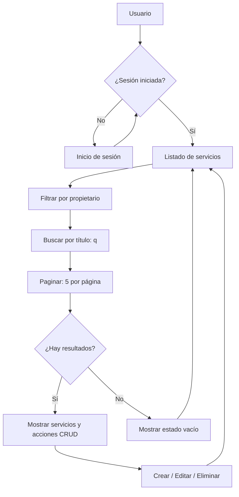

<div align="center">


# Unidad 4 · Semana 7
### Pulido funcional, experiencia de usuario y preparación de defensa

**Aplicaciones Web · Proyecto integrador Django**

[](https://www.python.org/)
[](https://www.djangoproject.com/)
[](https://aiven.io/)
[](https://tailwindcss.com/)
[](https://render.com/)

**Desarrollado por Sebastián Duarte Ruiz**

[](https://u4s7-duarte-ruiz-sebastian.onrender.com/servicios/?page=1)
[](https://github.com/duarteruizsebastian/u4s7-duarte-ruiz-sebastian)

</div>

---

## 📌 Descripción del proyecto

Esta práctica corresponde a la **Unidad 4, Semana 7** de Aplicaciones Web. Es una continuación del proyecto Django trabajado en las unidades anteriores.

Su objetivo es **mejorar el listado de servicios y preparar la aplicación para su presentación**, sin reemplazar el CRUD ni la autenticación ya implementados.

La aplicación permite que cada usuario registrado administre sus propios servicios: puede **crear, consultar, editar y eliminar** registros, sin acceder a los servicios de otras cuentas.

En esta semana se incorporaron **búsqueda por título**, **paginación de 5 registros** y **mensajes claros cuando no existen resultados**.

### 🌐 Enlaces del proyecto

| Recurso | Enlace |
|:--|:--|
| **Aplicación publicada** | [Abrir listado en Render](https://u4s7-duarte-ruiz-sebastian.onrender.com/servicios/?page=1) |
| **Código fuente** | [Repositorio U4S7 en GitHub](https://github.com/duarteruizsebastian/u4s7-duarte-ruiz-sebastian) |
| **Registro** | [Crear una cuenta](https://u4s7-duarte-ruiz-sebastian.onrender.com/registro/) |
| **Iniciar sesión** | [Acceder al sistema](https://u4s7-duarte-ruiz-sebastian.onrender.com/login/) |

> **Nota:** el listado requiere iniciar sesión. La URL de Render puede redirigir a `/login/` cuando no hay una sesión activa.

---

## ✨ Funcionalidades

| Módulo | ¿Qué permite hacer? |
|:--|:--|
| 🔐 **Autenticación** | Registrar usuarios, iniciar y cerrar sesión. |
| 🛡️ **Aislamiento de datos** | Consultar y modificar únicamente los servicios del usuario autenticado. |
| 📝 **CRUD** | Crear, listar, editar y eliminar servicios. |
| 🔎 **Búsqueda** | Filtrar servicios por título, sin distinguir entre mayúsculas y minúsculas. |
| 📄 **Paginación** | Mostrar **5 servicios por página** y navegar con «Anterior» y «Siguiente». |
| 📭 **Estados vacíos** | Diferenciar entre no tener servicios y no encontrar coincidencias en una búsqueda. |
| 📱 **Interfaz adaptable** | Mantener usable la tabla en pantallas pequeñas mediante desplazamiento horizontal. |
| ♿ **Accesibilidad básica** | Dar al campo de búsqueda un nombre accesible con `aria-label`. |

### 🆕 Mejoras desarrolladas en la Semana 7

- Se usa `filter(propietario=request.user)` para obtener solamente los registros de la sesión actual.
- Se ordenan los resultados por `-creado_en` y `-id` antes de paginar.
- Se aplica `titulo__icontains` cuando la URL tiene el parámetro `q`.
- Se divide la lista con `Paginator(lista_servicios, 5)`.
- Se conserva el texto de búsqueda al cambiar de página.
- Se muestran mensajes distintos cuando la lista está vacía o la búsqueda no encuentra resultados.
- La tabla utiliza `overflow-x-auto` para una mejor visualización en dispositivos móviles.

---

## 🧩 ¿Cómo funciona?



### Fragmento principal de la vista

```python
@login_required
def servicios(request):
    lista_servicios = Servicio.objects.filter(
        propietario=request.user
    ).order_by('-creado_en', '-id')

    query = request.GET.get('q', '').strip()
    if query:
        lista_servicios = lista_servicios.filter(titulo__icontains=query)

    paginator = Paginator(lista_servicios, 5)
    pagina = paginator.get_page(request.GET.get('page'))

    return render(request, 'core/servicios.html', {
        'servicios': pagina,
        'query': query,
    })
```

### Ejemplos de rutas

```text
/servicios/               → Listado completo del usuario
/servicios/?q=diseno      → Filtrar servicios por título
/servicios/?page=2        → Consultar la segunda página
/servicios/?q=web&page=2  → Buscar y paginar al mismo tiempo
```

---

## 🗂️ Estructura principal del proyecto

```text
u4s7-duarte-ruiz-sebastian/
├── core/
│   ├── migrations/
│   ├── templates/core/
│   │   ├── base.html
│   │   ├── inicio.html
│   │   ├── login.html
│   │   ├── registro.html
│   │   ├── servicios.html
│   │   ├── servicio_form.html
│   │   └── servicio_confirm_delete.html
│   ├── admin.py
│   ├── forms.py
│   ├── models.py
│   ├── urls.py
│   └── views.py
├── miproyecto_drs/
│   ├── settings.py
│   ├── urls.py
│   ├── asgi.py
│   └── wsgi.py
├── .env.example
├── .gitignore
├── manage.py
├── requirements.txt
└── README.md
```

---

## 🚀 Instalación y ejecución local

**Requisitos:**

- Python instalado.
- Conexión al servidor MySQL de Aiven.
- Git.

### 1. Clonar el repositorio

```bash
git clone https://github.com/duarteruizsebastian/u4s7-duarte-ruiz-sebastian.git
cd u4s7-duarte-ruiz-sebastian
```

### 2. Crear y activar el entorno virtual

Windows PowerShell:

```powershell
python -m venv venv
.\venv\Scripts\Activate.ps1
```

### 3. Instalar las dependencias

```bash
pip install -r requirements.txt
```

### 4. Configurar las variables de entorno

Crear un archivo `.env` con los datos de conexión a Aiven.

Si existe `.env.example`, puedes utilizarlo como referencia.

```powershell
Copy-Item .env.example .env
```

**Importante:** las contraseñas y claves privadas no deben publicarse en GitHub.

### 5. Preparar la base de datos

```bash
python manage.py check
python manage.py migrate
```

### 6. Iniciar el servidor

```bash
python manage.py runserver
```

Abrir en el navegador:

http://127.0.0.1:8000

---

## ☁️ Despliegue en Render

El proyecto utiliza:

- **Gunicorn:** para ejecutar la aplicación Django.
- **WhiteNoise:** para servir los archivos estáticos.
- **MySQL en Aiven:** como base de datos en la nube.
- **Render:** para publicar la aplicación.

| Configuración | Valor |
|:--|:--|
| Servicio | `u4s7-duarte-ruiz-sebastian` |
| Rama | `main` |
| Build Command | `pip install -r requirements.txt && python manage.py collectstatic --noinput && python manage.py migrate` |
| Start Command | `gunicorn miproyecto_drs.wsgi` |

### Variables de entorno necesarias

```dotenv
DB_NAME=nombre_de_tu_base
DB_USER=usuario_de_aiven
DB_PASSWORD=contrasena_privada
DB_HOST=host_de_aiven
DB_PORT=puerto_de_aiven
SECRET_KEY=clave_secreta_segura
DEBUG=False
ALLOWED_HOSTS=u4s7-duarte-ruiz-sebastian.onrender.com
CSRF_TRUSTED_ORIGINS=https://u4s7-duarte-ruiz-sebastian.onrender.com
```

> El archivo `.env` se utiliza de forma local. En Render, las variables se configuran desde **Environment**.

---

## 🧪 Pruebas de la Semana 7

Las siguientes pruebas permiten comprobar el funcionamiento de las mejoras realizadas.

- [ ] `python manage.py check` termina sin errores.
- [ ] Iniciar sesión y acceder a `/servicios/`.
- [ ] Crear al menos **6 servicios** para mostrar una segunda página.
- [ ] Comprobar «Página 1 de 2» y los enlaces «Anterior / Siguiente».
- [ ] Buscar una parte del título y obtener solamente coincidencias.
- [ ] Buscar `zzz` y visualizar el mensaje de resultados vacíos.
- [ ] Elegir «Quitar búsqueda» y recuperar el listado completo.
- [ ] Abrir `?page=99` y comprobar que muestra la última página disponible.
- [ ] Probar el listado en una pantalla pequeña de aproximadamente 375 px.
- [ ] Confirmar que un usuario no puede editar ni borrar servicios ajenos.
- [ ] Verificar el sitio publicado sin errores visibles de servidor.

### Revisión de interfaz (UI Review)

| Aspecto | Mejora implementada |
|:--|:--|
| **Accesibilidad** | Se agregó `aria-label` al buscador y a la paginación. |
| **Responsividad** | Se utilizó `overflow-x-auto` para visualizar la tabla en celulares. |
| **Estados vacíos** | Se agregaron mensajes para cuando no existen servicios o resultados de búsqueda. |

**Hallazgos adicionales del compañero:** pendientes de registrar después de realizar la revisión por pares.

---

## 🎤 Preparación de la defensa

Durante la presentación del proyecto se puede realizar el siguiente recorrido:

1. Explicar qué problema resuelve el sistema y mostrar la aplicación publicada.
2. Iniciar sesión y explicar por qué cada usuario solamente puede visualizar sus propios servicios.
3. Mostrar las operaciones CRUD.
4. Crear el sexto servicio y demostrar el funcionamiento de la paginación.
5. Buscar un servicio por título y mostrar los mensajes de resultados vacíos.
6. Explicar brevemente el papel de Django, MySQL en Aiven y Render.

---

## 📚 Referencias

- [Django — Pagination](https://docs.djangoproject.com/en/stable/topics/pagination/)
- [Django — QuerySet Field Lookups](https://docs.djangoproject.com/en/stable/ref/models/querysets/#icontains)
- [Django — Template for y empty](https://docs.djangoproject.com/en/stable/ref/templates/builtins/#for)
- [Django — Authentication](https://docs.djangoproject.com/en/stable/topics/auth/)
- [Tailwind CSS — Responsive Design](https://tailwindcss.com/docs/responsive-design)
- [Render — Deploy a Django App](https://render.com/docs/deploy-django)

---

<div align="center">

**Unidad 4 · Semana 7 — Aplicaciones Web**  
**Sebastián Duarte Ruiz**

*Proyecto académico desarrollado con Django, MySQL y Tailwind CSS.*

[⬆️ Volver al inicio](#unidad-4--semana-7)

</div>
